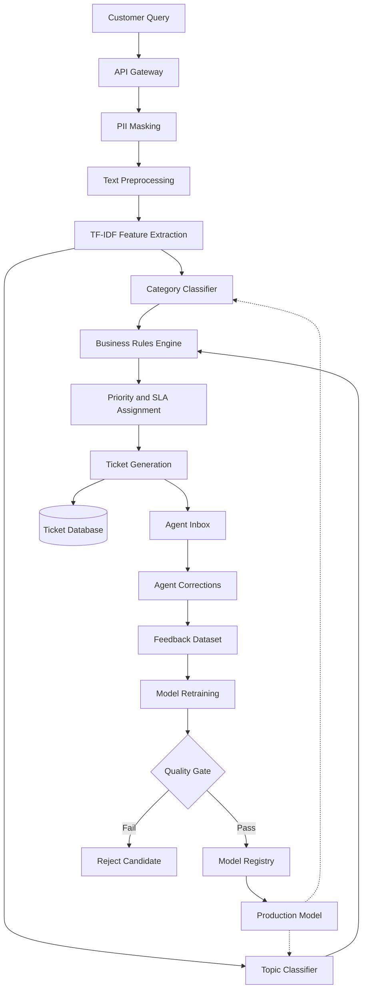
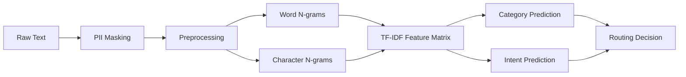
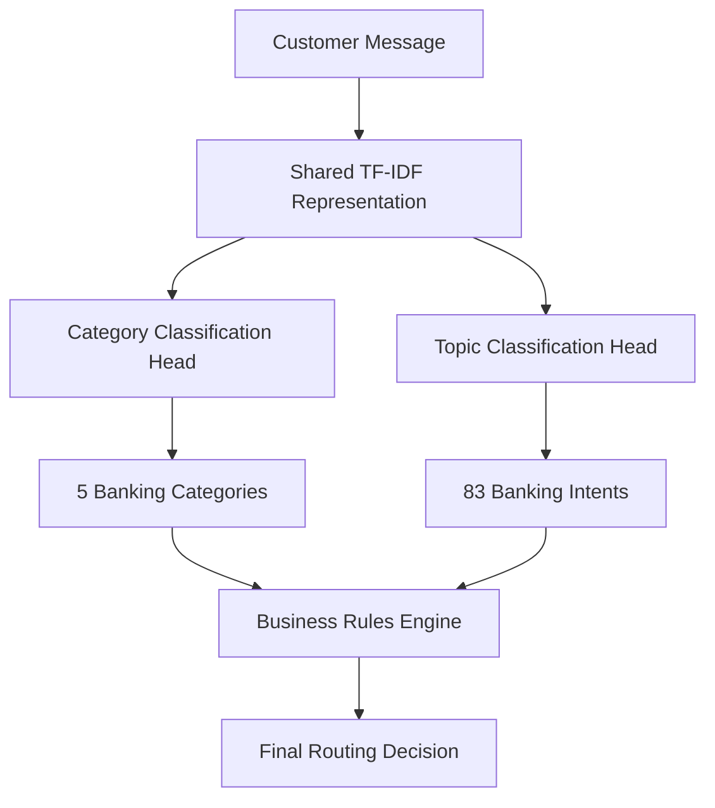
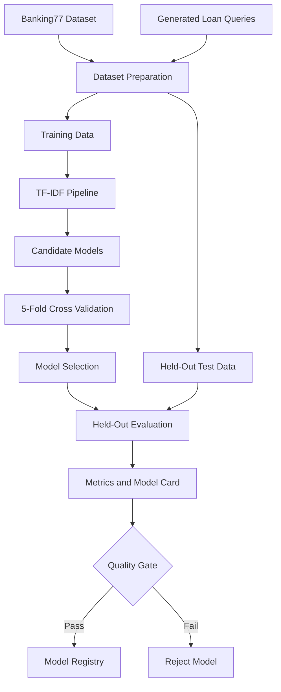
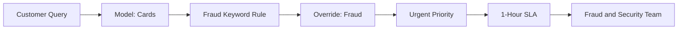
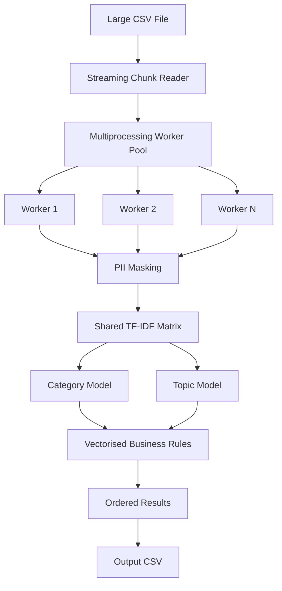
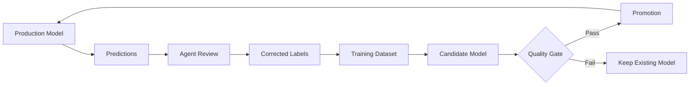
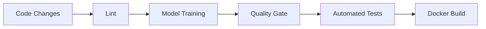

<div align="center">

# 🏦 Routing Desk

### Intelligent Banking Query Classification & Routing Platform

An end-to-end NLP-powered banking automation platform that classifies customer queries, protects sensitive information, and intelligently routes requests to the appropriate department with priority-based SLA management.


---

| Classification Accuracy | Macro F1 Score | Banking Intents | Peak Throughput |
| :---: | :---: | :---: | :---: |
| **97.3%** | **0.974** | **83** | **51,799 queries/sec** |

*Privacy-first · Explainable AI · Intelligent Routing · Continuous Learning*

</div>

---

## 📑 Table of Contents

- [Overview](#-overview)
- [Problem Statement](#-problem-statement)
- [Key Features](#-key-features)
- [System Architecture](#-system-architecture)
- [NLP Pipeline](#-nlp-pipeline)
- [Dataset](#-dataset)
- [Model Training and Selection](#-model-training-and-selection)
- [Evaluation Results](#-evaluation-results)
- [Business Rules Engine](#-business-rules-engine)
- [Privacy and Security](#-privacy-and-security)
- [Performance and Scalability](#-performance-and-scalability)
- [Technology Stack](#-technology-stack)
- [Getting Started](#-getting-started)
- [API Documentation](#-api-documentation)
- [Model Lifecycle](#-model-lifecycle)
- [Configuration](#-configuration)
- [Project Structure](#-project-structure)
- [Acknowledgements](#-acknowledgements)

---

## 📖 Overview

**Routing Desk** is an intelligent banking customer-support automation platform built using Natural Language Processing, Machine Learning and production-oriented software engineering principles.

The system processes incoming customer messages from different channels, identifies their underlying intent, applies configurable banking policies and automatically generates actionable support tickets.

Unlike conventional text classification systems, Routing Desk combines machine learning with deterministic business rules, privacy-preserving preprocessing, model governance and human-in-the-loop learning.

### Supported Banking Categories

| Category | Example Customer Query |
|---|---|
| 💳 Cards | My debit card is not working. |
| 💸 Payments | My payment has been deducted but not received. |
| 🏠 Loans | How can I apply for a personal loan? |
| 👤 Account Issues | I cannot access my bank account. |
| 🛡️ Fraud | Someone made an unauthorised transaction. |

The system further classifies messages into **83 fine-grained banking intents**, enabling more precise ticket routing.

---

## 🎯 Problem Statement

Banks receive large volumes of customer queries across mobile applications, websites and other customer-support channels.

Traditional manual routing introduces several challenges:

- High operational workload.
- Incorrect department assignment.
- Delayed handling of critical fraud cases.
- Exposure of sensitive customer information.
- Inconsistent ticket prioritisation.
- Limited learning from agent corrections.

Routing Desk addresses these challenges through automated classification, intelligent ticket routing, privacy protection and continuous model improvement.

---

## ✨ Key Features

| Feature | Description |
|---|---|
| Intelligent Classification | Five banking categories and 83 fine-grained intents |
| NLP Feature Engineering | TF-IDF with word and character n-grams |
| Privacy Protection | Automatic masking of personally identifiable information |
| Hybrid Decision Engine | Machine learning combined with configurable business rules |
| Fraud Escalation | Immediate escalation of high-risk banking queries |
| Explainable AI | Word-level explanations and rule execution history |
| Confidence-Based Routing | Low-confidence predictions sent for manual review |
| Ticket Management | Assignment, status tracking, notes and event history |
| SLA Management | Automated priority and response deadlines |
| Human-in-the-Loop Learning | Agent corrections captured for retraining |
| Model Governance | Versioned models, model cards and quality gates |
| High-Throughput Processing | Chunked, parallel bulk classification |
| Observability | Prometheus metrics, structured logs and health checks |
| Interactive Dashboard | Live classification, inbox, analytics and model views |
| Containerised Deployment | Docker, Docker Compose and CI automation |

---

## 🏗️ System Architecture

Routing Desk follows a modular architecture that separates text processing, machine learning inference, business decisions, ticket management and model governance.



For detailed architectural decisions, refer to [Architecture Documentation](docs/ARCHITECTURE.md).

---

## 🧠 NLP Pipeline

The NLP pipeline converts unstructured customer messages into machine-readable numerical representations and predicts their banking category and specific intent.



### 1. Text Preprocessing

Incoming messages are processed through privacy-preserving preprocessing before being passed to the classification models.

Sensitive information is replaced with appropriate placeholders.

Example:

```text
Original:
My card 4539 1488 0343 6467 was skimmed at the ATM.

Processed:
My card [CARD] was skimmed at the ATM.
```

### 2. TF-IDF Feature Extraction

Term Frequency-Inverse Document Frequency converts textual information into weighted numerical features.

TF-IDF assigns higher importance to words that frequently occur within a document but are relatively uncommon across the complete corpus.

This helps distinguish banking-specific terms such as:

- chargeback
- unauthorised
- repayment
- declined
- verification
- transfer

#### Why TF-IDF?

- Computationally efficient.
- Effective for short banking queries.
- Produces sparse, memory-efficient feature representations.
- Compatible with linear classification algorithms.
- Supports interpretable feature-level predictions.
- Enables high-throughput CPU-based inference.

### 3. Word and Character N-grams

Both word-level and character-level n-grams are used to capture lexical patterns.

| Feature Type | Example |
|---|---|
| Word unigram | `payment` |
| Word bigram | `payment failed` |
| Word trigram | `payment was declined` |
| Character trigram | `pay`, `aym`, `yme` |

Character-level features improve robustness against spelling variations and typographical errors, while word-level features capture meaningful phrases.

The examples above illustrate n-grams; the actual configured ranges are defined in the model pipeline.

### 4. Dual Classification Architecture

The system contains two classification heads:

| Model | Responsibility |
|---|---|
| Category Classifier | Predicts one of five major banking categories |
| Topic Classifier | Predicts one of 83 specific banking intents |

Both classifiers can consume the same transformed feature matrix during bulk inference, eliminating redundant feature extraction.



---

## 📊 Dataset

### Banking77

The project uses the **Banking77** dataset, a benchmark dataset designed for fine-grained banking intent classification.

| Property | Description |
|---|---|
| Domain | Banking customer support |
| Original Banking77 Intents | 77 |
| Additional Loan Intents | 6 |
| Total Supported Intents | 83 |
| High-Level Categories | 5 |
| Held-Out Evaluation Queries | 3,192 |
| Language | English |
| Dataset License | CC BY 4.0 |

### Loan Dataset Augmentation

The original Banking77 dataset does not contain loan-related intents.

To extend domain coverage, additional loan queries are generated using 60 templates covering six loan topics.

The training and testing data are separated by template to reduce direct template leakage and evaluate unseen phrasings.

Generated loan queries remain a limitation because they may not fully represent the complexity of real customer conversations.

### Dataset Source

[Banking77 — PolyAI Task-Specific Datasets](https://github.com/PolyAI-LDN/task-specific-datasets)

---

## ⚙️ Model Training and Selection

Multiple machine learning algorithms are evaluated using TF-IDF feature representations and five-fold cross-validation.

### Evaluated Models

| Model | Characteristics |
|---|---|
| Logistic Regression | Efficient linear classifier with probability estimates |
| Linear SVM | Maximum-margin classification for high-dimensional features |
| Complement Naive Bayes | Probabilistic classifier suitable for imbalanced text datasets |

### Training Workflow



### Why Logistic Regression?

Logistic Regression was selected as the production classifier through the model-selection workflow.

Its advantages include:

- Strong cross-validation performance.
- Efficient inference on sparse TF-IDF features.
- Direct probability estimates for confidence-based routing.
- Interpretable feature contributions.
- Low computational overhead.
- Suitability for CPU-based parallel processing.

The held-out test set is reserved for final evaluation and is not used for model selection.

---

## 📈 Evaluation Results

### Overall Classification Performance

Evaluated on a held-out test set containing **3,192 queries**.

| Evaluation Metric | Result |
|---|:---:|
| Category Accuracy | **97.3%** |
| Macro F1 Score | **0.974** |
| Fraud Recall | **95.8%** |
| Topic Accuracy | **89.9%** |
| Top-3 Topic Accuracy | **96.7%** |
| Majority-Class Baseline Accuracy | 46.4% |

### Model Comparison

| Model | Hyperparameter | CV Macro F1 | Test Macro F1 |
|---|---|---|---|
| **Logistic Regression** | C = 20 | **0.966 ± 0.004** | **0.974** |
| Linear SVM | C = 1 | 0.966 ± 0.005 | 0.957 |
| Complement Naive Bayes | α = 0.1 | 0.940 ± 0.007 | 0.949 |

### Classification Performance Overview

```text
Category Accuracy    97.3%  ███████████████████░
Macro F1             97.4%  ███████████████████░
Fraud Recall         95.8%  ███████████████████░
Top-3 Topic Accuracy 96.7%  ███████████████████░
Topic Accuracy       89.9%  ██████████████████░░
Baseline Accuracy    46.4%  █████████░░░░░░░░░░░
```

### Why Macro F1?

Macro F1 evaluates each category independently and gives equal importance to every class, making it suitable for banking datasets where some categories may contain fewer samples.

Fraud recall is evaluated separately because missing a genuine fraud query can have significant financial consequences.

Every training run generates model metadata, evaluation figures and misclassified examples inside:

```text
models/registry/<version>/
```

---

## 🔀 Business Rules Engine

Machine learning predictions are combined with configurable banking policies to make the final routing decision.

The rules are maintained in:

```text
configs/routing_rules.yaml
```

This separation allows banking policies to be updated independently without retraining the NLP models.

### Supported Routing Policies

- Confidence-based manual review.
- Two-tier fraud escalation.
- Priority overrides for sensitive cases.
- Department assignment.
- SLA deadline calculation.
- Secondary category identification.
- Rule execution auditing.

### Fraud Escalation Example

Consider the following customer query:

```text
My card was skimmed at the ATM.
```

The model may classify it under Cards, but the business rules identify the strong fraud indicator `skimmed` and override the routing decision.



Strong fraud indicators trigger escalation, while ambiguous terms require additional model support.

### Priority Management

| Priority | Typical Use Case |
|---|---|
| Urgent | Fraud and account takeover |
| High | Sensitive complaints and priority overrides |
| Normal | General banking queries |

Response deadlines range from **one hour for fraud cases to 48 hours for loan-related queries**, according to configured routing rules.

Predictions below the configured **60% confidence threshold** are flagged for manual review.

---

## 🔐 Privacy and Security

Routing Desk masks personally identifiable information before classification, storage and logging.

### Supported PII Detection

| Sensitive Information | Handling |
|---|---|
| Credit/Debit Card Numbers | Luhn-validated detection and masking |
| IBAN | Masking |
| Bank Account Numbers | Masking |
| Sort Codes | Masking |
| Email Addresses | Masking |
| Phone Numbers | Masking |

### Security Features

- Optional API key authentication.
- Request rate limiting.
- Request ID tracking.
- Privacy-preserving logging.
- Non-root Docker execution.
- Configurable environment variables.
- Health and readiness checks.

> API authentication is disabled when no API keys are configured. This mode should only be used for local development.

PII masking reduces exposure of supported sensitive identifiers but does not, by itself, establish regulatory compliance or guarantee detection of every sensitive value.

---

## 🚀 Performance and Scalability

Routing Desk supports large-scale query classification through a chunked, multiprocessing bulk inference engine.

Instead of independently transforming text for each classifier, the optimised pipeline performs feature extraction once per chunk and shares the resulting matrix across both classification heads.

### Bulk Processing Architecture



### Benchmark Environment

| Hardware | Specification |
|---|---|
| Processor | Apple M2 |
| CPU Cores | 8 |
| Performance Cores | 4 |
| Efficiency Cores | 4 |
| Memory | 8 GB |
| Benchmark Size | 1,000,000 queries |

### Throughput Benchmarks

| Configuration | Queries/Second | Processing Time |
|---|---:|---:|
| Original implementation, 1 core | 7,367 | ~136 seconds |
| Shared feature extraction, 1 core | 13,120 | ~76 seconds |
| Parallel processing, 4 cores | 44,259 | 22.6 seconds |
| **Parallel processing, 8 cores** | **51,799** | **19.3 seconds** |

```text
Original       7,367  ███
1 Core        13,120  █████
4 Cores       44,259  █████████████████
8 Cores       51,799  ████████████████████
```

### Performance Highlights

- Approximately **7× higher throughput** compared with the original implementation.
- One million queries processed in approximately **19.3 seconds**.
- Shared TF-IDF feature extraction.
- Parallel CPU-based inference.
- Vectorised business rule execution.
- Approximately 400 MB memory usage per worker.
- Deterministic output across worker configurations.
- Bulk and individual routing consistency verified through tests.

These benchmarks measure the bulk routing engine, including PII masking and business rules. They should not be interpreted as concurrent HTTP API throughput or ticket database write capacity.

### Running the Bulk Benchmark

```bash
make bulk-demo

python -m bankq.bulk data/bulk/demo_1m.csv -o routed.csv
```

The generated benchmark contains one million rows constructed from Banking77 test sentences.

Large files can also be processed through the Batch dashboard or the asynchronous jobs API.

---

## 🛠️ Technology Stack

| Layer | Technologies |
|---|---|
| Programming Language | Python |
| Natural Language Processing | TF-IDF, Word N-grams, Character N-grams |
| Machine Learning | Scikit-learn |
| Classification Algorithms | Logistic Regression, Linear SVM, Complement Naive Bayes |
| Backend Framework | FastAPI |
| Database | SQLite, SQLAlchemy |
| Database Compatibility | PostgreSQL |
| Data Processing | Chunked Processing, Multiprocessing |
| Model Governance | Versioned Model Registry, Model Cards |
| Monitoring | Prometheus, Structured JSON Logging |
| API Documentation | OpenAPI, Swagger UI |
| Testing | Automated Unit, Model, Rules and API Tests |
| DevOps | Docker, Docker Compose, GitHub Actions |
| Configuration | YAML, Environment Variables |

---

## 💻 Application Dashboard

Routing Desk provides an interactive dashboard for managing the complete customer-query lifecycle.

| Dashboard View | Functionality |
|---|---|
| Live Routing | Real-time classification and routing visualisation |
| Inbox | Ticket assignment, status management and manual review |
| Batch | Large-scale CSV processing and result downloads |
| Analytics | Query volumes, confidence, deadlines and correction rates |
| Models | Production model information and version history |

The interface supports responsive layouts and light and dark themes.

The live network visualisation represents actual classifier outputs; it is a visual representation rather than the underlying neural network architecture.

---

## ⚡ Getting Started

### Prerequisites

- Python
- Git
- Make
- Docker and Docker Compose (optional)

### Installation

Clone the repository and navigate to the project directory.

```bash
make install
```

### Train the Model

```bash
make train
```

This command trains, evaluates, registers and promotes a model when it passes the quality gate.

### Seed Demo Data

```bash
make seed
```

Generates 14 days of demonstration tickets for the Inbox and Analytics dashboards.

### Start the Application

```bash
make serve
```

Open the application:

| Service | URL |
|---|---|
| Application | http://127.0.0.1:8077 |
| Swagger API Documentation | http://127.0.0.1:8077/docs |
| Prometheus Metrics | http://127.0.0.1:8077/metrics |
| Health Check | http://127.0.0.1:8077/health |
| Readiness Check | http://127.0.0.1:8077/ready |

### Run Tests

```bash
make test
```

### Docker Deployment

```bash
docker compose up --build
```

The Docker image trains the model during the build process, runs as a non-root user and includes a health check.

---

## 🔌 API Documentation

All application endpoints are versioned under:

```text
/api/v1
```

### Classify a Customer Query

```bash
curl -X POST http://127.0.0.1:8077/api/v1/classify \
  -H "Content-Type: application/json" \
  -d '{
    "text": "My card 4539 1488 0343 6467 was skimmed at the ATM",
    "channel": "app"
  }'
```

### Example Response

```json
{
  "text": "My card [CARD] was skimmed at the ATM",
  "pii_redacted": ["CARD"],
  "category": "fraud",
  "model_category": "cards",
  "intent": {
    "intent": "lost_or_stolen_card",
    "label": "Lost or stolen card"
  },
  "department": "Fraud & Security Team",
  "priority": "urgent",
  "sla_hours": 1,
  "rules_applied": [
    {
      "rule": "fraud_escalation",
      "detail": "strong fraud phrase “skimmed”; model said Cards 100%, fraud 0%"
    }
  ],
  "ticket_ref": "TKT-000629"
}
```

The response demonstrates how the deterministic business rules can override a machine learning prediction when a strong fraud indicator is detected.

### Available Endpoints

| Method | Endpoint | Description |
|---|---|---|
| POST | `/api/v1/classify` | Classify and route a customer query |
| POST | `/api/v1/classify/batch` | Classify up to 1,000 messages by default |
| POST | `/api/v1/classify/csv` | Upload and classify CSV data |
| POST | `/api/v1/jobs` | Submit an asynchronous bulk job |
| GET | `/api/v1/jobs/{id}` | Retrieve job progress |
| GET | `/api/v1/jobs/{id}/preview` | Preview processed results |
| GET | `/api/v1/jobs/{id}/result` | Download routed CSV |
| GET | `/api/v1/tickets` | Retrieve and filter tickets |
| GET | `/api/v1/tickets/{ref}` | Retrieve individual ticket |
| PATCH | `/api/v1/tickets/{ref}` | Update, assign or re-route ticket |
| GET | `/api/v1/analytics/summary` | Retrieve operational analytics |
| GET | `/api/v1/model` | Retrieve production model details |
| GET | `/api/v1/model/versions` | Retrieve model registry |
| POST | `/api/v1/admin/reload-model` | Reload production model and rules |
| GET | `/health` | Application liveness |
| GET | `/ready` | Application readiness |
| GET | `/metrics` | Prometheus metrics |

Single-message classification creates a ticket unless `create_ticket: false` is specified.

Interactive API documentation is available at `/docs`.

---

## 🔄 Model Lifecycle

Routing Desk implements a human-in-the-loop machine learning workflow.

Agent corrections are collected as labelled feedback and can be incorporated into subsequent training runs.



### Model Quality Gate

A candidate model must satisfy the following requirements:

| Metric | Minimum Requirement |
|---|---:|
| Macro F1 Score | ≥ 0.93 |
| Fraud Recall | ≥ 0.90 |
| Topic Accuracy | ≥ 0.80 |
| Macro F1 Regression | No more than 0.01 |

Models that fail the quality gate are rejected from automatic production promotion.

### Model Cards

Each registered model contains information about:

- Model version.
- Dataset fingerprint.
- Hyperparameters.
- Evaluation metrics.
- Intended usage.
- Known limitations.
- Evaluation figures.
- Misclassified examples.

### Model Management Commands

```bash
# Train and register a candidate model
make train

# Retrain using agent feedback
make retrain

# List registered model versions
make models

# Promote a specific model version
make promote V=v2026...

# Reload the production model
curl -X POST http://localhost:8077/api/v1/admin/reload-model
```

Hot reloading allows the production model to be updated without restarting the application.

---

## 📡 Monitoring and Observability

The system exposes operational metrics through Prometheus and structured JSON logs.

Monitored information includes:

- Incoming request volume.
- Request processing latency.
- Category distribution.
- Business rule execution.
- PII redaction counts.
- Manual review rates.
- Ticket re-routing rates.
- Confidence scores.
- SLA deadlines.

Health and readiness endpoints support deployment monitoring and operational checks.

### Continuous Integration



GitHub Actions automates the linting, model training, quality validation, testing and container build workflow.

---

## 🔧 Configuration

Application settings are managed through environment variables.

Refer to `.env.example` for configuration examples.

| Environment Variable | Purpose |
|---|---|
| `BANKQ_API_KEYS` | Comma-separated API authentication keys |
| `BANKQ_DATABASE_URL` | SQLAlchemy database connection URL |
| `BANKQ_RATE_LIMIT_PER_MINUTE` | API request rate limit |
| `BANKQ_MAX_BATCH_SIZE` | Maximum synchronous batch size |
| `BANKQ_LOG_JSON` | Enable structured JSON logging |
| `BANKQ_BULK_WORKERS` | Number of multiprocessing workers |
| `BANKQ_BULK_CHUNK_SIZE` | Chunk size, default 20,000 |
| `BANKQ_MAX_UPLOAD_MB` | Maximum upload size, default 1,024 MB |

Setting `BANKQ_BULK_WORKERS=0` configures the bulk engine to use available CPU cores.

SQLite is used by default. PostgreSQL can be configured through the database connection URL.

---

## 📁 Project Structure

```text
Routing-Desk/
│
├── bankq/
│   ├── config.py
│   ├── logging_setup.py
│   ├── taxonomy.py
│   │
│   ├── data/
│   │   ├── Dataset loading
│   │   ├── Loan data generation
│   │   ├── Preprocessing
│   │   └── Validation
│   │
│   ├── ml/
│   │   ├── Feature pipeline
│   │   ├── Model training
│   │   ├── Model registry
│   │   ├── Predictor
│   │   └── Transformer (planned)
│   │
│   ├── routing/
│   │   ├── PII masking
│   │   ├── Business rules
│   │   ├── Router
│   │   └── Notifications (planned)
│   │
│   ├── db/
│   │   ├── Database models
│   │   ├── Session management
│   │   └── Repository
│   │
│   ├── api/
│   │   ├── Application
│   │   ├── Dependencies
│   │   ├── Schemas
│   │   ├── Observability
│   │   └── Routes
│   │
│   └── monitoring/
│       └── Drift monitoring (planned)
│
├── configs/
│   └── routing_rules.yaml
│
├── models/
│   └── registry/
│
├── web/
├── scripts/
│   └── seed_demo.py
│
├── tests/
├── docs/
│   └── ARCHITECTURE.md
│
├── .github/
│   └── workflows/
│
├── .env.example
├── Dockerfile
├── Makefile
├── pyproject.toml
├── TASKS.md
└── README.md
```

The structure above describes the logical responsibilities of each module.

---


## 📚 Acknowledgements

This project uses the Banking77 dataset introduced in:

**Efficient Intent Detection with Dual Sentence Encoders**

Iñigo Casanueva, Tadas Temčinas, Daniela Gerz, Matthew Henderson and Ivan Vulić, 2020.

- [Banking77 Dataset Repository](https://github.com/PolyAI-LDN/task-specific-datasets)
- Dataset License: CC BY 4.0
- [Scikit-learn Documentation](https://scikit-learn.org/)
- [FastAPI Documentation](https://fastapi.tiangolo.com/)

---

<div align="center">

### Routing Desk

**Transforming unstructured banking conversations into intelligent, actionable decisions.**

Built with Natural Language Processing, Machine Learning and software engineering principles.

⭐ Star this repository if you find the project useful.

</div>
